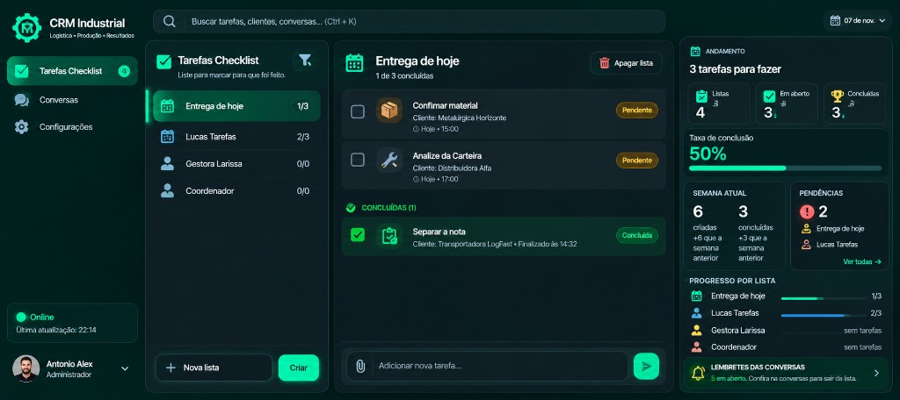
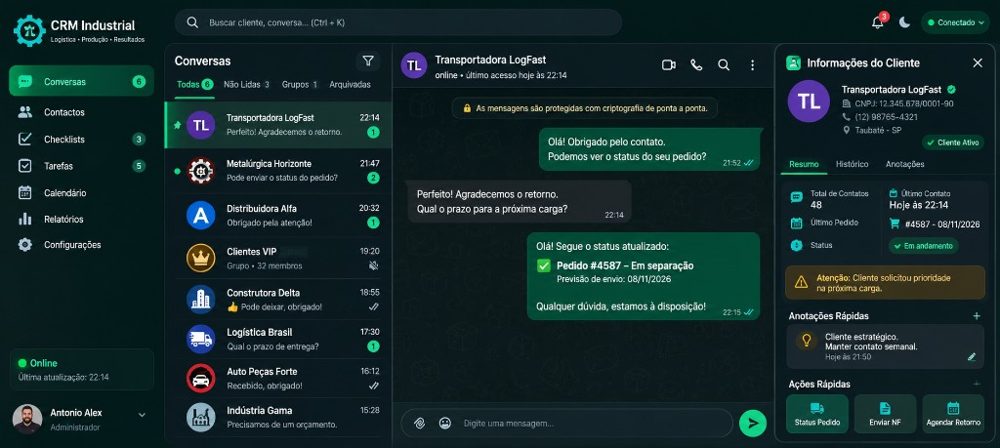

# CRM Industrial

Comunicação entre setores tratada como melhoria contínua. O CRM reúne o pedido que chega de fora, a demanda de quem executa e o registro do que já foi feito. O projeto está em evolução, aplicado a uma indústria, e o código da aplicação permanece fechado.

Este repositório guarda o raciocínio, a estrutura, a segurança e fotos do sistema em uso. Conversas de clientes não são publicadas.

## O problema que a ferramenta ataca

No chão de fábrica e na logística, a informação costuma nascer no WhatsApp e morrer no celular de uma pessoa. O comercial combina um prazo. A produção não vê. A logística cobra de novo. O financeiro pergunta o que foi prometido. Cada setor tem um pedaço da história, e ninguém tem o fio inteiro.

Isso é desperdício de comunicação: retrabalho de pergunta, tarefa esquecida e decisão tomada em cima de recado solto. Melhoria contínua, aqui, começa por padronizar esse fluxo. O que entra vira registro. O que está em aberto fica visível. O que foi concluído sai da frente e permanece no histórico.

O ciclo é o da rotina, não o de um relatório anual:

1. **Registrar.** A mensagem ou a demanda do dia entra no CRM.
2. **Executar.** O colaborador vê a própria lista e a conversa de origem.
3. **Medir.** O andamento mostra o que falta, o que fechou e a taxa de conclusão da semana.
4. **Ajustar.** A lista, a prioridade e o responsável mudam conforme a operação mostra o furo.

A ferramenta custa pouco porque a base é software aberto, hospedado pela própria operação. O investimento vai para o ajuste ao processo, não para uma licença fechada de prateleira.

## Quem conduz

O projeto junta produção industrial e logística. A organização do trabalho é o método. O CRM é o meio.

**Antonio Alex Silva Ferreira**  
Estudante de Engenharia e Tecnologia de Gestão da Produção Industrial. O desenho parte da melhoria contínua digital: padronizar a informação, tornar a demanda visível e medir o que a equipe realmente cumpre.

[LinkedIn](https://www.linkedin.com/in/antonio-alex-silva-ferreira-65434a298/)

**Bruna Raphaela de Paula**  
Cursa bacharelado em Administração e atua em logística. Entra com o fluxo externo: prazo, entrega, cliente e o que precisa atravessar de um setor para o outro sem se perder no caminho.

[LinkedIn](https://www.linkedin.com/in/bruna-raphaela-de-paula-4427802bb/)

Chão de fábrica e administração logística no mesmo sistema. A ferramenta continua sendo ajustada à rotina real, não a um modelo genérico de mercado.

## O CRM como ponte entre setores

Uma conversa não fica presa em quem atendeu primeiro. Ela pode ser marcada por setor, atribuída a uma pessoa e consultada por quem entra depois. Produção, logística, comercial, financeiro e diretoria deixam de depender do encaminhamento manual de um print.

| Função | O que melhora na comunicação |
| --- | --- |
| Conversas | O atendimento do WhatsApp fica na operação, no computador e no celular, com histórico. O próximo setor lê o que já foi dito. |
| Setor na conversa | A conversa recebe o setor responsável. O pedido deixa de circular sem dono. |
| Responsável | Alguém fica atribuído. A demanda tem nome, não “alguém vê”. |
| Etiqueta | O estado do assunto fica marcado, por exemplo quando já foi resolvido, sem apagar a conversa. |
| Ficha do contato | Telefone, canal e contexto ficam junto da conversa. O externo não precisa ser reconstruído a cada turno. |
| Atividade na mensagem | Do recado nasce uma atividade: título, origem, prioridade, responsável e situação. A conclusão é feita na conversa, onde o fato aconteceu. |
| Cheqlist | A demanda diária vira lista. O colaborador abre, marca o que cumpriu e lança o que ainda falta. O concluído fica separado do que está em aberto. |
| Andamento | Listas, em aberto, concluídas, taxa de conclusão, comparação da semana, pendências e progresso de cada lista. O número sai da tarefa registrada. |
| Lembrete da conversa | A atividade criada no atendimento aparece no Cheqlist, com botão para voltar à conversa. Quando a conversa a encerra, o lembrete sai da lista. |
| Celular | No turno, a tela mostra uma função de cada vez: lista de conversas, conversa aberta ou Cheqlist. A volta fica no cabeçalho da conversa. |
| Mais de uma operação | O acesso é por empresa. A rotina de uma não se mistura com a da outra. |

O Cheqlist não substitui a conversa, e a conversa não substitui a lista. Um guarda o combinado com o cliente. O outro guarda o que o colaborador tem de cumprir no dia. O lembrete liga os dois.

## Como está estruturado

A operação sobe com Docker Compose. Cada parte é um serviço, reinicia sozinha e guarda os próprios dados.

| Serviço | Função |
| --- | --- |
| Traefik | Única entrada da internet. Entrega o site em HTTPS. |
| Aplicação | Tela e API do CRM. |
| Sidekiq | Fila do que não pode travar a tela: envio e processamento em segundo plano. |
| PostgreSQL 16 | Conversas, contatos, atividades, Cheqlist e usuários. |
| Redis | Fila, cache e sessão. Exige senha e grava em disco. |
| Conector de WhatsApp | Liga o canal à operação. Permanece na rede interna. |

Há duas redes. A borda publica só o site. Banco, Redis e conector de WhatsApp ficam na rede interna.

## Segurança

A proteção foi montada em camadas, da porta da internet até a senha de quem entra.

- A internet só chega pelo Traefik, nas portas 80 e 443. HTTP é enviado para HTTPS. O certificado é emitido e renovado sem intervenção manual.
- O painel do Traefik fica desligado. Serviço que não for marcado para publicação não aparece fora.
- O navegador recebe proteção de cabeçalho: a página não entra em outro site, o tipo do arquivo não é adivinhado, a referência de origem é restrita e o HTTPS é exigido por um período longo.
- PostgreSQL, Redis e o conector de WhatsApp não têm porta aberta para a internet. Só a aplicação da borda fala com eles.
- Banco e Redis usam senha. As senhas não estão neste repositório. São geradas no servidor e lidas por variável de ambiente.
- A senha de cada pessoa fica só como hash. O sistema não a devolve. O cadastro público está fechado: entra quem recebeu acesso.
- Cada serviço sobe sem permissão para elevar privilégio. O log tem tamanho limitado, para não encher o disco.

## Evolução

O que já está na rotina:

1. A tela de trabalho com a identidade da operação.
2. Conversas do dia, com histórico para o setor seguinte.
3. Atividade nascida na mensagem e encerrada na conversa.
4. Cheqlist da demanda diária e andamento medido em cima do que foi registrado.
5. Uso no celular, no mesmo fluxo da lista, da conversa e da tarefa.

O ajuste seguinte sai da observação do turno: o que o colaborador não acha, o que o outro setor pergunta de novo, o que a lista ainda não cobre. Melhoria contínua aqui é mudança pequena, com o processo na frente da ferramenta.

## Fotos

Cheqlist do dia. A lista aberta, o que ainda falta, o que já foi concluído e o andamento ao lado.

Conversas. O atendimento fica reunido, com o histórico e a ficha de quem está do outro lado.

## Código

O código da aplicação, as senhas, as conversas e os dados da operação não são publicados. Este repositório é a vitrine do projeto.
