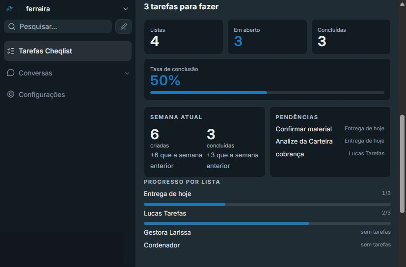

# CRM Industrial

**Em evolução.** Uma ferramenta para melhorar a comunicação e a dinâmica de serviço na indústria.

O código da aplicação permanece fechado. Este repositório mostra o problema, a forma de organizar o trabalho, a base técnica e a segurança. As fotos são do sistema em uso. Conversas de clientes não entram aqui.

O sistema está sendo levado para uma indústria, para a comunicação ficar clara entre os setores: tanto dentro da empresa quanto com quem está fora.

## Quem conduz

Duas pessoas uniram o chão de fábrica e a logística.

**Antonio Alex Silva Ferreira**  
Estudante de Engenharia e Tecnologia de Gestão da Produção Industrial. Não é programador. Traz ideias e soluções de melhoria contínua digital, em que a organização também é melhoria, e procura ferramentas de custo baixo ou zero.

[LinkedIn](https://www.linkedin.com/in/antonio-alex-silva-ferreira-65434a298/)

**Bruna Raphaela de Paula**  
Cursa bacharelado em Administração e atua em logística.

[LinkedIn](https://www.linkedin.com/in/bruna-raphaela-de-paula-4427802bb/)

O conhecimento de produção e o conhecimento de logística e administração estão no mesmo lugar. A ferramenta segue em desenvolvimento, para se ajustar cada vez mais ao que a operação precisa.

## O que o colaborador usa

- **Conversas.** O atendimento do dia fica reunido, no computador e no celular.
- **Atividade na conversa.** Uma demanda nasce na mensagem. A conclusão acontece na própria conversa.
- **Cheqlist.** A demanda diária fica registrada para o colaborador cumprir. O andamento mostra listas, o que está em aberto, o que já foi feito e a taxa de conclusão. Os números saem das tarefas reais.
- **Lembretes.** A atividade criada na conversa aparece no Cheqlist, com um caminho de volta para a conversa. Quando ela é concluída na conversa, sai da lista.

## Como está estruturado

Tudo sobe com **Docker Compose**. Cada parte é um serviço, com reinício automático e volume próprio para os dados.

| Serviço | Função |
| --- | --- |
| Traefik | Única porta de entrada da internet. Recebe o site e entrega em HTTPS. |
| Aplicação | Tela e API do CRM. |
| Sidekiq | Fila de trabalho em segundo plano. |
| PostgreSQL 16 | Conversas, tarefas, usuários e o Cheqlist. |
| Redis | Fila, cache e sessão. Exige senha e grava os dados em disco. |
| Conector de WhatsApp | Liga o atendimento ao canal. Fica só na rede interna. |

Há duas redes. A borda fala com o site. O banco, o Redis e o conector de WhatsApp ficam na rede interna.

O software de base é aberto e hospedado pela própria operação. A licença desses componentes não é o custo. O ajuste é feito em cima dessa base, para a indústria, sem montar um sistema fechado de prateleira.

## Segurança

A segurança foi desenhada em camadas, do acesso da internet até a senha de quem entra.

- A internet só entra pelo Traefik, nas portas 80 e 443. O endereço em HTTP é enviado para HTTPS. O certificado é emitido e renovado de forma automática.
- O painel do Traefik fica desligado. Contêiner que não for marcado para isso não aparece na internet.
- O navegador recebe cabeçalhos de proteção: página não pode ser encaixada em outro site, o tipo do arquivo não é adivinhado, a referência de origem é restrita e o HTTPS é exigido por um tempo longo.
- PostgreSQL, Redis e o conector de WhatsApp não têm porta publicada para fora. Só a aplicação da borda fala com eles.
- Redis e PostgreSQL usam senha. Essas senhas não estão neste repositório. São geradas no servidor e lidas por variável de ambiente.
- A senha de cada pessoa é guardada só como hash. O sistema não devolve a senha. O cadastro público está fechado: entra quem já recebeu acesso.
- Cada serviço sobe sem permissão para ganhar privilégios novos. O registro de log tem tamanho limitado, para não encher o disco.

## Evolução

O produto não está fechado. O que já está em uso:

1. Identidade da operação na tela de trabalho.
2. Conversas organizadas para o uso diário.
3. Atividade ligada à conversa, com conclusão na conversa e lembrete no Cheqlist.
4. Andamento do Cheqlist com os números reais da demanda.
5. Uso no celular: uma função por vez, lista, conversa e Cheqlist no mesmo fluxo.

O próximo passo continua sendo o mesmo: observar a rotina da indústria e ajustar a ferramenta ao que o colaborador precisa cumprir no dia.

## Fotos

Cheqlist no dia de trabalho. A lista aberta, o que falta e o que já foi concluído.

Andamento. Os números vêm das tarefas que existem, não de uma meta inventada.

## Código

O código da aplicação, as senhas, as conversas e os dados da operação **não são publicados**. Este repositório é a vitrine do projeto: o raciocínio, a estrutura e a evolução.
