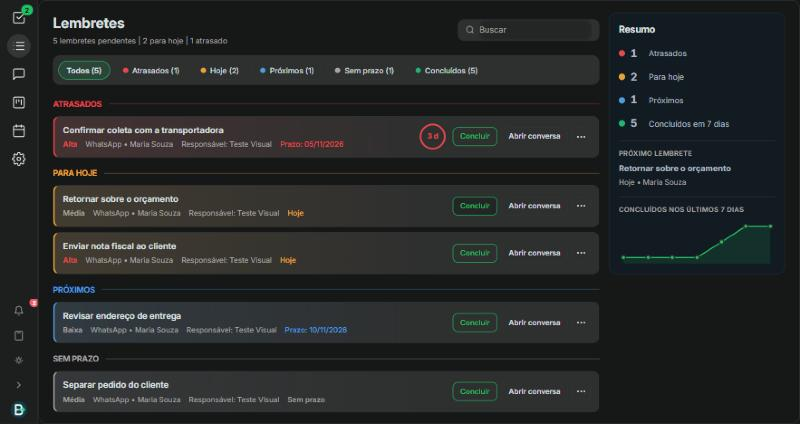
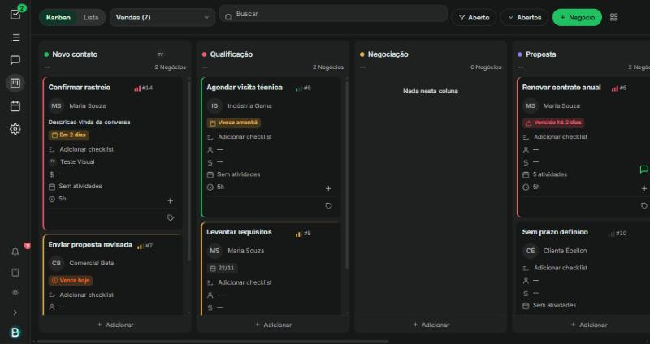
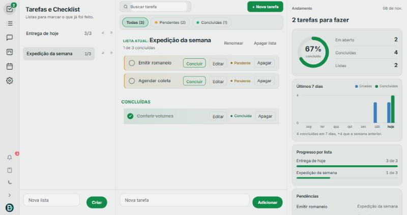
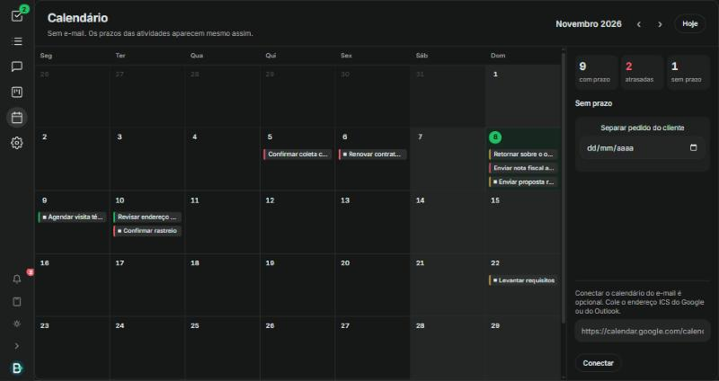

# CRM Industrial

Comunicação entre setores tratada como melhoria contínua. O CRM reúne o pedido que chega de fora, a demanda de quem executa e o registro do que já foi feito. O projeto está em evolução, aplicado a uma operação real, e o código da aplicação permanece fechado.

Este repositório guarda o raciocínio, a estrutura, a segurança e fotos do sistema. As fotos usam dados de demonstração. Conversas de clientes não são publicadas.

## O problema que a ferramenta ataca

No chão de fábrica e na logística, a informação costuma nascer no WhatsApp e morrer no celular de uma pessoa. O comercial combina um prazo. A produção não vê. A logística cobra de novo. O financeiro pergunta o que foi prometido. Cada setor tem um pedaço da história, e ninguém tem o fio inteiro.

Isso é desperdício de comunicação: retrabalho de pergunta, tarefa esquecida e decisão tomada em cima de recado solto. Melhoria contínua, aqui, começa por padronizar esse fluxo. O que entra vira registro. O que está em aberto fica visível. O que foi concluído sai da frente e permanece no histórico.

O ciclo é o da rotina, não o de um relatório anual:

1. **Registrar.** A mensagem ou a demanda do dia entra no CRM.
2. **Executar.** O colaborador vê a própria lista, o quadro e a conversa de origem.
3. **Medir.** O andamento mostra o que falta, o que fechou, o que atrasou e quanto tempo cada item está parado.
4. **Ajustar.** A lista, a prioridade, o responsável e as colunas mudam conforme a operação mostra o furo.

A ferramenta custa pouco porque a base é software aberto, hospedado pela própria operação. O investimento vai para o ajuste ao processo, não para uma licença fechada de prateleira.

## Engenharia de produção aplicada

O sistema é o meio. O que ele organiza vem da gestão da produção.

| Conceito | Onde aparece no sistema |
| --- | --- |
| Gestão visual | Kanban com colunas definidas pela própria operação e cor automática por prazo, e cor de prioridade no contato da lista de conversas. O estado do trabalho é visto sem perguntar a ninguém. |
| Fluxo e tempo em etapa | Cada card mostra há quanto tempo está na coluna. O histórico soma o tempo por etapa, e o gargalo aparece. |
| Padronização | Modelos de quadro por tipo de operação e checklist específico para cada serviço. |
| Prevenção de erro | A mesma conversa não abre dois cards no mesmo quadro, excluir pede confirmação e arquivar permite voltar atrás. |
| Redução de desperdício | Alerta um dia antes e no dia do prazo, para a cobrança não depender da memória de alguém. |
| Indicador do que foi registrado | Taxa de conclusão, atrasados, próximos e concluídos da semana saem das tarefas reais, não de preenchimento manual. |

O Kanban foi feito para servir a qualquer tipo de empresa. Os nomes dos itens, do cliente, do prazo e do que é concluído são definidos em cada quadro.

## Quem conduz

O projeto junta produção industrial e logística. A organização do trabalho é o método. O CRM é o meio.

**Antonio Alex Silva Ferreira**  
Estudante de Engenharia e Tecnologia de Gestão da Produção Industrial. O desenho parte da melhoria contínua digital: padronizar a informação, tornar a demanda visível e medir o que a equipe realmente cumpre.

[LinkedIn](https://www.linkedin.com/in/antonio-alex-silva-ferreira-65434a298/)

**Bruna Raphaela de Paula**  
Cursa bacharelado em Administração e atua em logística. Entra com o fluxo externo: prazo, entrega, cliente e o que precisa atravessar de um setor para o outro sem se perder no caminho.

[LinkedIn](https://www.linkedin.com/in/bruna-raphaela-de-paula-4427802bb/)

Chão de fábrica e administração logística no mesmo sistema. A ferramenta continua sendo ajustada à rotina real, não a um modelo genérico de mercado.

## O CRM como ponte entre setores

Uma conversa não fica presa em quem atendeu primeiro. Ela pode ser marcada por setor, atribuída a uma pessoa e consultada por quem entra depois. Produção, logística, comercial, financeiro e diretoria deixam de depender do encaminhamento manual de um print.

| Função | O que melhora na comunicação |
| --- | --- |
| Conversas | O atendimento do WhatsApp fica na operação, no computador e no celular, com histórico. O próximo setor lê o que já foi dito. |
| Setor na conversa | A conversa recebe o setor responsável. O pedido deixa de circular sem dono. |
| Responsável | Alguém fica atribuído. A demanda tem nome, não “alguém vê”. |
| Etiqueta | O estado do assunto fica marcado, por exemplo quando já foi resolvido, sem apagar a conversa. |
| Ficha do contato | Telefone, canal e contexto ficam junto da conversa. O externo não precisa ser reconstruído a cada turno. |
| Mensagem privada | A equipe combina dentro da conversa, com cor própria e autor em cada nota, sem nada sair para o cliente. |
| Grupos do WhatsApp | Cada participante aparece com foto ou iniciais, e o nome de quem falou aparece uma vez só. |
| Origem do envio | Dá para ver se a mensagem saiu do celular ou de uma pessoa no CRM. |
| Atividade na mensagem | Do recado nasce uma atividade: título, origem, prioridade, responsável, situação e prazo. Se fizer sentido, ela já vira um card. |
| Botão direito na conversa | Atividade e card são criados direto da lista, sem abrir a conversa. |
| Contato na lista | O contato assume a cor da maior prioridade em aberto, e um selo mostra que ele já tem card. Quem abre a lista vê o que pesa antes de clicar. |
| Lembretes | As atividades se organizam em atrasados, para hoje, próximos e sem prazo, com concluir e voltar à conversa na mesma linha. |
| Kanban | Quadros pessoais e da empresa, colunas livres, cards fechados ou abertos, prioridade por cor e arrastar entre etapas. |
| Conversa ao lado do quadro | O card abre a conversa do WhatsApp em um painel lateral, sem perder a posição no quadro. |
| Checklist no card | Cada serviço tem a própria lista, e o card mostra a taxa de progresso. |
| Calendário | Prazos de cards e atividades, agendamentos e reuniões em uma visão só. |
| Alertas de prazo | Sino na barra lateral e aviso no navegador, um dia antes e no dia, pelo horário de São Paulo. |
| Tarefas e Checklist | A demanda diária vira lista. O colaborador abre, marca o que cumpriu, edita e lança o que ainda falta. |
| Andamento | Listas, em aberto, concluídas, taxa de conclusão, comparação da semana e progresso de cada lista. O número sai da tarefa registrada. |
| Calculadora | Janela flutuante que se arrasta por cima da conversa, para fazer a conta sem sair do atendimento. |
| Celular | No turno, a tela mostra uma função de cada vez, com a volta no cabeçalho da conversa. |
| Mais de uma operação | O acesso é por empresa. A rotina de uma não se mistura com a da outra. |

As Tarefas não substituem a conversa, e a conversa não substitui a lista. Uma guarda o combinado com o cliente. A outra guarda o que o colaborador tem de cumprir no dia. O lembrete liga as duas.

## Como está estruturado

A operação sobe com Docker Compose. Cada parte é um serviço, reinicia sozinha e guarda os próprios dados.

| Serviço | Função |
| --- | --- |
| Traefik | Única entrada da internet. Entrega o site em HTTPS. |
| Aplicação | Tela e API do CRM. |
| Sidekiq | Fila do que não pode travar a tela: envio, rotina de alertas e processamento em segundo plano. |
| PostgreSQL 16 | Conversas, contatos, atividades, quadros, tarefas e usuários. |
| Redis | Fila, cache e sessão. Exige senha e grava em disco. |
| Conector de WhatsApp | Liga o canal à operação. Permanece na rede interna. |

Há duas redes. A borda publica só o site. Banco, Redis e conector de WhatsApp ficam na rede interna.

## Segurança

A proteção foi montada em camadas, da porta da internet até a senha de quem entra.

- A internet só chega pelo Traefik, nas portas 80 e 443. HTTP é enviado para HTTPS. O certificado é emitido e renovado sem intervenção manual.
- O painel do Traefik fica desligado. Serviço que não for marcado para publicação não aparece fora.
- O navegador recebe proteção de cabeçalho: o tipo do arquivo não é adivinhado, a referência de origem é restrita e o HTTPS é exigido por um período longo.
- PostgreSQL, Redis e o conector de WhatsApp não têm porta aberta para a internet. Só a aplicação da borda fala com eles.
- Banco e Redis usam senha. As senhas não estão neste repositório. São geradas no servidor e lidas por variável de ambiente.
- A senha de cada pessoa fica só como hash. O sistema não a devolve. O cadastro público está fechado: entra quem recebeu acesso.
- As permissões são validadas no servidor. Quadro pessoal só o dono vê, e quem não tem acesso a uma caixa de entrada não enxerga a conversa dela, mesmo vinculada a um card.
- Cada serviço sobe sem permissão para elevar privilégio. O log tem tamanho limitado, para não encher o disco.

## Como cada mudança é validada

Primeiro em um ambiente separado, com dados de demonstração. Só depois vai para a operação.

- Antes de publicar: cópia do banco, com leitura conferida, e cópia da versão em uso para poder voltar.
- Mudança de banco é apresentada antes, só acrescenta e foi testada também no caminho de volta.
- O Kanban passou por 108 verificações de API em criação, edição, vínculos, movimentação e permissões. Alertas e checklist, por mais 38.
- Em teste de carga com 3.000 cards em 6 colunas, o quadro abriu em cerca de 340 ms, carregando só o que aparece na tela.

## Evolução

O que já está na rotina:

1. A tela de trabalho com a identidade da operação e tema claro e escuro.
2. Conversas do dia, com histórico para o setor seguinte.
3. Atividade nascida na mensagem e encerrada na conversa.
4. Tarefas da demanda diária e andamento medido em cima do que foi registrado.
5. Uso no celular, no mesmo fluxo da lista, da conversa e da tarefa.
6. Kanban adaptável, com conversa lateral, checklist por serviço e tempo em cada etapa.
7. Calendário de prazos e alertas automáticos.

O ajuste seguinte sai da observação do turno: o que o colaborador não acha, o que o outro setor pergunta de novo, o que a lista ainda não cobre. Melhoria contínua aqui é mudança pequena, com o processo na frente da ferramenta.

## Fotos

Lembretes. O que está atrasado, o que vence hoje e o que vem depois, com o resumo ao lado.

Kanban. Colunas da própria operação, cor por prazo e prioridade, tempo na etapa e checklist no card.

Tarefas e Checklist. A lista aberta, o que ainda falta, o que já foi concluído e o andamento ao lado.

Calendário. Prazos de cards e atividades em um só lugar.

Conversas. O atendimento fica reunido, com o histórico e a identificação de quem enviou.

## Código

O código da aplicação, as senhas, as conversas e os dados da operação não são publicados. Este repositório é a vitrine do projeto. A base de atendimento é o Chatwoot Community Edition, de licença MIT; os módulos descritos aqui foram construídos sobre ela.
